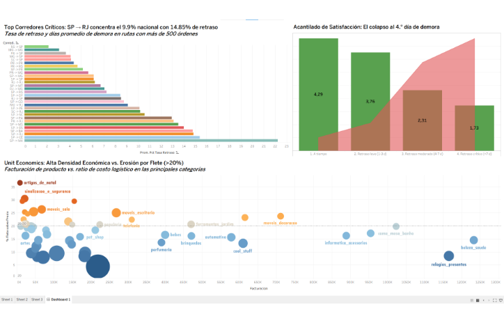
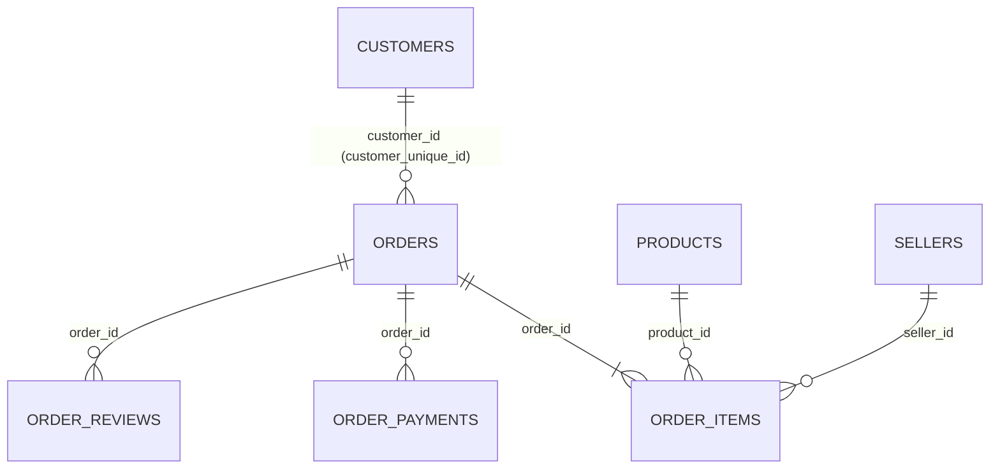
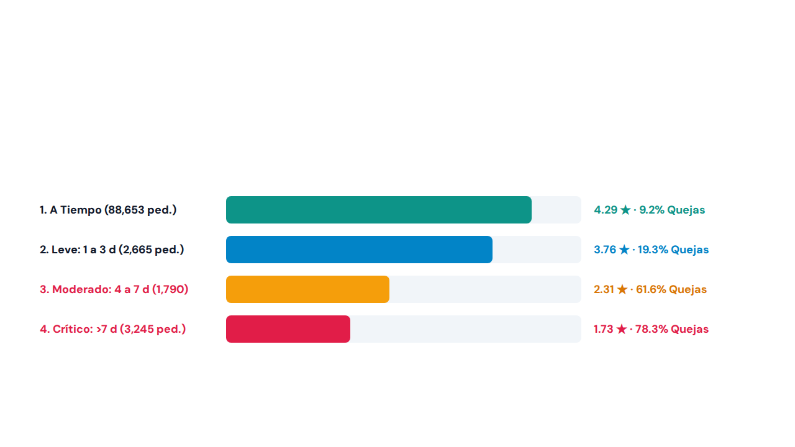

# 🛒 Auditoría Operativa y Financiera E-Commerce: Caso Olist (BigQuery SQL & Tableau)

[](./sql_scripts/)
[](https://public.tableau.com/views/Brazil_ecomercce/Dashboard1?:language=es-ES&:sid=&:redirect=auth&:display_count=n&:origin=viz_share_link)
[](./Olist%20E-Commerce_%20Auditor%C3%ADa%20Operativa%20y%20Financiera.pptx)
[]()

**Autor:** Juan E. Lund — *Business & Operations Data Analyst*  
**Alcance Auditado:** 99,441 registros brutos → **96,470 órdenes entregadas certificadas** · **93,350 clientes únicos** · **7 tablas relacionales**  
**Impacto Anual Proyectado:** **R$ 1,230,000 en valor de negocio** (~R$ 680k en GMV protegido + R$ 550k en GMV incremental sin CAC)

---

## 🎯 1. Síntesis Ejecutiva (Answer-First)

El crecimiento en volumen bruto (GMV) de Olist oculta **tres fugas estructurales silenciosas** que erosionan la reputación de marca, el margen de contribución y el retorno sobre el costo de adquisición (CAC):
1. **Colapso de Satisfacción al 4.° Día de Atraso (*SLA Cliff*) y Bloqueo de Última Milla en Río de Janeiro:** El cliente tolera de 1 a 3 días de demora (3.76 ★ | 19.32% detractores), pero al cruzar el **4.° día** la calificación se desploma a **2.31 ★ (61.62% detractores)**. El epicentro nacional es la ruta **`SP -> RJ`** (9,403 pedidos; 9.91% del país), que falla en el **14.85%** de los envíos. Al descomponer en SQL los tiempos de despacho (*First-Mile*) vs. tránsito (*Last-Mile*), demostré que el vendedor despacha en **4.6 días**, mientras que el transportista tarda **31.3 días** en los pedidos atrasados (**87.2% del tiempo perdido ocurre en manos del correo estatal**).
2. **Erosión de Unit Economics (>23% Flete) y Falla Algorítmica en Carritos Multi-Ítem:** Categorías voluminosas de bajo ticket como `moveis_decoracao` (R$ 87.25; **23.65% flete**) y `utilidades_domesticas` (R$ 90.60; **23.19% flete**) superan el umbral crítico del 20%. La auditoría a nivel de línea de ítem reveló que en **6,570 órdenes con 2+ unidades idénticas del mismo vendedor**, el algoritmo cobró el **100% del flete por cada unidad adicional (0 órdenes con descuento por consolidación)**, elevando el peso del envío al 27.4% y castigando la compra por volumen.
3. **Dependencia Extrema del CAC (97.00% Clientes *One-Shot*) e Impacto del SLA en la Recompra:** Rastreando a los 93,350 compradores reales (`customer_unique_id`) con funciones de ventana `ROW_NUMBER()` y `LAG()`, comprobé que solo el **3.00% (2,801 clientes)** realiza más de una compra. De ellos, el 30.5% (853) son carritos divididos el mismo día (<24h) y el 69.5% (1,948) presenta un ciclo de reposición real de **81.7 a 116.8 días**. Además, **sufrir un atraso logístico en la primera compra hunde la probabilidad de recompra en un -17.4% relativo** (de 3.04% a 2.51%).

### Cuadro de Mando de Hallazgos e Intervenciones Estratégicas

| Pilar Auditado | Métrica Base Certificada | Causa Raíz Demostrada en SQL (BigQuery) | Plan de Acción Quirúrgico (Fase Act) | Impacto Anual Proyectado |
| :--- | :---: | :--- | :--- | :---: |
| **1. Logística y SLAs** | **91.89%** SLA general (88,644 a tiempo; 7,826 tarde) | **Acantilado al 4.° día:** cae de 3.76 ★ a **2.31 ★** (61.62% quejas). En **`SP -> RJ`** (14.85% atraso), el *seller* tarda **4.6d** y el *carrier* **31.3d** (87.2% del fallo). | **Operación Desbloqueo RJ** (enrutamiento a *carriers* privados / Lockers PUDO con 15% dto.) + **Gatillo Preventivo a las 72h** (WhatsApp T+24h). | **~R$ 680,000** en GMV protegido y -40% tickets de soporte. |
| **2. Unit Economics y Flete** | Top 10 Categorías (R$ 8.25M ventas; umbral 20% flete) | **Falla algorítmica multi-ítem:** en **6,570 órdenes** con 2+ unidades idénticas se cobró 100% de flete por cada ítem extra (`moveis_decoracao`: **23.65%** flete). | **Regla de Flete Incremental (*Same-Seller Bundling* > R$ 150):** bonificar 50% del flete desde la 2.ª unidad del mismo *seller* + **Geo-Priorización Local**. | **+R$ 310,000** en GMV incremental (ratio flete baja de 23.6% a ~14.8%). |
| **3. Retención y Cohortes** | **93,350** clientes únicos (97.00% *One-Shot*) | **Bifurcación e impacto SLA:** 30.5% carritos divididos (<24h) y 69.5% recompra real (**81.7–116.8d**). El atraso en la 1.ª orden reduce la recompra un **-17.4%**. | **Motor de LTV en el Día 65 (`beleza_saude`):** campaña de reposición exclusiva para clientes entregados *On-Time* (<= SLA) + **Tarjeta QR física In-Box**. | **+R$ 240,000** en GMV recurrente con CAC = R$ 0 (meta 7.5% recompra). |

---

## 📊 2. Dashboard Ejecutivo en Tableau Public

🔗 **[Explorar el Dashboard Interactivo en Vivo en Tableau Public (`Brazil_ecomercce/Dashboard1`)](https://public.tableau.com/views/Brazil_ecomercce/Dashboard1?:language=es-ES&:sid=&:redirect=auth&:display_count=n&:origin=viz_share_link)**



* **Panel Superior Izquierdo (Ranking de Corredores Críticos):** Identifica el cuello de botella en `SP -> RJ` (9.91% del volumen nacional, 14.85% de retraso y 12.6 días de demora extra) junto con el bloqueo receptor desde `PR -> RJ` (13.09%) y `SC -> RJ` (10.17%).
* **Panel Superior Derecho (Acantilado de Satisfacción — *SLA Cliff*):** Gráfico de eje dual que cruza la caída abrupta de estrellas (barras) contra la explosión del porcentaje de detractores (área roja) al cruzar el 4.° día de retraso.
* **Panel Inferior (Matriz de Unit Economics y Fricción por Flete):** Diagrama de dispersión que contrasta la facturación por categoría frente al ratio Flete/Precio, trazando la línea de alerta en el umbral crítico del **20.0%**.

---

## 🗄️ 3. Arquitectura de Datos y Gobernanza en Google BigQuery

### 3.1 Modelo Relacional de las 7 Tablas Auditadas


### 3.2 Embudo de Conciliación y Reglas de Limpieza (`vw_orders_clean`)
Antes de calcular promedios de entrega o facturación, se auditó el universo bruto de **99,441 órdenes** en BigQuery para aislar el ruido operativo y cuantificar la pérdida por quiebres de inventario:

| Estado Operativo (`order_status`) | Volumen de Órdenes | % del Total Bruto | Entregas sin Fecha (`NULL`) | Regla de Gobernanza Analítica y Financiera Aplicada |
| :--- | :---: | :---: | :---: | :--- |
| **`delivered` (Certificadas)** | **96,470** | **97.01%** | 0 (8 excluidas) | Población oficial en [`01_vw_orders_clean.sql`](./sql_scripts/01_vw_orders_clean.sql) para auditoría de SLAs, rutas y reseñas. |
| **`delivered` (Incompletas)** | 8 | 0.01% | 8 | Excluidas de cálculos de `DATETIME_DIFF` para evitar distorsión por fechas nulas. |
| **`shipped` (En tránsito)** | 1,107 | 1.11% | 1,107 | Órdenes despachadas al transportista sin cierre de última milla al corte del dataset. |
| **`canceled` (Canceladas)** | 625 | 0.63% | 619 (6 entregadas) | Excluidas de GMV neto; 6 órdenes con fecha indican devolución post-entrega. |
| **`unavailable` (Quiebre stock)** | 609 | 0.61% | 609 | Fuga operativa directa por inventario fantasma del *seller* (~R$ 97k perdidos). |
| **`invoiced` / `processing` / Otros** | 622 | 0.63% | 622 | Incluye `invoiced` (314), `processing` (301), `created` (5) y `approved` (2). |
| **Total General Auditado** | **99,441** | **100.00%** | **2,965** | **Fuga operativa (`canceled` + `unavailable`): 1,234 órdenes (1.24% bruta / ~R$ 197k GMV).** |

---

## 🔍 4. Análisis Profundo de los 3 Pilares y Evidencia de Causa Raíz

### 4.1 Pilar 1: El Acantilado del 4.° Día (*SLA Cliff*) y Desglose *First-Mile* vs. *Last-Mile*
📄 **Script SQL:** [`02_sla_cliff_and_last_mile_audit.sql`](./sql_scripts/02_sla_cliff_and_last_mile_audit.sql) · **Dataset de Salida:** [`01_corredores_logisticos_bigquery.csv`](./data_results/01_corredores_logisticos_bigquery.csv) & [`03_sla_cliff_satisfaccion_bigquery.csv`](./data_results/03_sla_cliff_satisfaccion_bigquery.csv)



| Tramo de Entrega vs. SLA | Evaluaciones | % del Volumen | Calificación Promedio (★) | % Detractores (1 y 2 ★) | % Promotores (5 ★) | Diagnóstico de Experiencia de Cliente |
| :--- | :---: | :---: | :---: | :---: | :---: | :--- |
| **1. A tiempo o antes (<= SLA)** | 88,653 | 92.00% | **4.29 ★** | 9.23% | 62.43% | Estándar saludable de operación; motor de confianza. |
| **2. Retraso leve (1 a 3 días)** | 2,665 | 2.77% | **3.76 ★** | **19.32%** | 43.08% | **Ventana de gracia de 72 horas:** el cliente aún tolera la demora. |
| **3. Retraso moderado (4 a 7 días)** | 1,790 | 1.86% | **2.31 ★** | **61.62%** | 17.82% | **El Acantilado (*SLA Cliff*):** las quejas se triplican al cruzar el 4.° día. |
| **4. Retraso crítico (> 7 días)** | 3,245 | 3.37% | **1.73 ★** | **78.34%** | 7.52% | Destrucción total de marca y saturación de soporte. |

#### Descomposición de Tiempos en Corredores: ¿Falla el Vendedor (*First-Mile*) o el Transportista (*Last-Mile*)?
| Corredor Logístico | Volumen Pedidos | % Peso Nacional | Despacho Seller (General) | Tránsito Carrier (General) | Despacho Seller (En Atrasos) | Tránsito Carrier (En Atrasos) | % Tasa Retraso | Diagnóstico de Causa Raíz Operativa |
| :--- | :---: | :---: | :---: | :---: | :---: | :---: | :---: | :--- |
| **`SP -> RJ` (Foco #1)** | 9,403 | **9.91%** | 3.1 días | 12.6 días | **4.6 días** | **31.3 días** | **14.85%** | **Colapso Last-Mile (87.2% carrier):** bloqueo postal en RJ (~R$ 197k GMV atrasado). |
| **`PR -> RJ`** | 1,115 | 1.17% | 3.1 días | 13.5 días | **5.5 días** | **34.2 días** | **13.09%** | Confirma que el problema es el estado receptor (RJ) y no el origen. |
| **`SP -> BA`** | 2,626 | 2.77% | 2.9 días | 16.3 días | 3.5 días | 32.2 días | 14.78% | Fricción de larga distancia hacia el Nordeste sin *hub* local. |
| **`SP -> CE`** | 1,091 | 1.15% | 2.9 días | 17.6 días | 3.8 días | 35.8 días | 15.40% | Mayor demora de tránsito interestatal (>20 días promedio). |
| **Envíos Mismo Estado** | 39,861 | **36.18%** | 2.8 días | 4.7 días | 6.1 días | 13.5 días | **5.98%** | **Benchmark de eficiencia:** entrega total en 7.9 días (94.02% SLA). |

---

### 4.2 Pilar 2: Unit Economics y Falla Algorítmica en Carritos Multi-Ítem
📄 **Script SQL:** [`03_unit_economics_and_multi_item_freight.sql`](./sql_scripts/03_unit_economics_and_multi_item_freight.sql) · **Dataset de Salida:** [`02_unit_economics_categorias_bigquery.csv`](./data_results/02_unit_economics_categorias_bigquery.csv)

> **Hallazgo Crítico en `order_items`:** En **6,570 órdenes con 2 o más unidades idénticas del mismo vendedor**, el motor de checkout cobró el **100% del flete por cada unidad adicional (0 órdenes con descuento por consolidación)**. Como consecuencia, en Muebles y Bazar los carritos de 2+ ítems sufren un ratio Flete/Precio superior (27.4%–28.2%) al de los carritos de 1 solo ítem (21.8%).

| Categoría de Producto | Órdenes | Ítems / Orden | Facturación (R$) | Costo Total Flete (R$) | Ticket Promedio (R$) | % Flete sobre Precio | Diagnóstico de Unit Economics (Umbral Crítico: 20%) |
| :--- | :---: | :---: | :---: | :---: | :---: | :---: | :--- |
| **`beleza_saude` (#1)** | 8,647 | 1.09 | R$ 1,233,132 | R$ 178,958 | R$ 130.28 | **14.51%** | **Estrella de LTV:** Alta facturación, flete sano y producto consumible. |
| **`relogios_presentes` (#2)** | 5,493 | 1.07 | R$ 1,165,899 | R$ 98,118 | R$ 199.06 | **8.42%** | **Líder en Densidad Económica:** Alto ticket y bajo peso volumétrico. |
| **`cama_mesa_banho` (#3)** | 9,272 | 1.18 | R$ 1,023,435 | R$ 201,775 | R$ 93.44 | 19.72% | **Volumen en Alerta:** Mayor número de órdenes, en el límite del 20%. |
| **`moveis_decoracao` (#6)** | 6,307 | 1.29 | R$ 711,928 | R$ 168,402 | R$ 87.25 | **23.65%** | **Erosión Severa (>20%):** Cobro lineal de flete por unidad castiga el margen. |
| **`utilidades_domesticas` (#7)** | 5,743 | 1.18 | R$ 615,629 | R$ 142,764 | R$ 90.60 | **23.19%** | **Erosión Severa (>20%):** Requiere descuento de flete incremental en 2.ª unidad. |

---

### 4.3 Pilar 3: Retención de Cohortes (`ROW_NUMBER` & `LAG`) e Impacto del SLA en el LTV
📄 **Script SQL:** [`04_cohort_retention_and_sla_impact.sql`](./sql_scripts/04_cohort_retention_and_sla_impact.sql)

| Segmento de Fidelidad (`customer_unique_id`) | Clientes Únicos | % de la Base Total | Días Promedio hasta Recompra | Diagnóstico Estratégico de Crecimiento (Growth & CRM) |
| :--- | :---: | :---: | :---: | :--- |
| **1 Compra (One-Shot)** | **90,549** | **97.00%** | N/A | **Fuga masiva de CAC:** El negocio financia adquisición paga sin retención orgánica. |
| **2 Compras (Promedio General)** | 2,573 | 2.76% | **81.7 días** | Incluye tanto carritos divididos en el checkout como recompras de ciclo de vida. |
| ↳ *Sub-segmento: Split-Cart (<24h)* | *853* | *0.91%* | *<1.0 día* | *30.5% de los recurrentes son órdenes simultáneas divididas por el checkout en el mismo día.* |
| ↳ *Sub-segmento: Ciclo Real (>= 24h)* | *1,948* | *2.09%* | **116.8 días** | *69.5% son recompras genuinas con maduración trimestral (65 a 115 días).* |
| **3+ Compras (Cliente Fiel)** | 228 | 0.24% | **68.7 días** | Aceleración del hábito una vez superada la barrera de la segunda compra. |

---

## 🚀 5. Plan de Acción Estratégico (Fase Act) y Gobernanza Experimental A/B

### Iniciativa 1 (Logística y SLA): "Operación Desbloqueo RJ" + Gatillo Preventivo a las 72 Horas
1. **Bypass Postal y Red PUDO en Río de Janeiro:** En los códigos postales (CEPs) de RJ catalogados como zonas de restricción domiciliaria, desviar automáticamente el despacho desde Correios hacia *carriers* privados (Jadlog / Sequoia) y desplegar en checkout la opción **"Retiro Seguro en Locker / Punto PUDO con 15% OFF en flete"**, erradicando los 31.3 días de tránsito en pedidos atrasados.
2. **Gatillo Automatizado a las 72 Horas (`SLA Breach T+24h`):** Disparar comunicación proactiva vía WhatsApp/Email a las 24 horas de vencido el SLA estimado (dentro de la ventana de gracia de 3.76 ★) con *tracking* prioritario y un cupón de contención de R$ 15 antes de que la orden cruce el 4.° día (2.31 ★).
3. **Scorecard Algorítmico de Sellers (Cut-off 48h):** Penalizar en visibilidad del *Buy Box* a los vendedores que excedan 48 horas en despachar o superen el 2% de órdenes `unavailable`, recuperando ~R$ 197,000 en GMV perdido.

### Iniciativa 2 (Unit Economics): Regla de Flete Incremental (*Same-Seller Bundling* > R$ 150) + Geo-Priorización
1. **Reingeniería del Motor de Tarifas (*Same-Seller Bundling*):** Reprogramar el checkout en `moveis_decoracao`, `utilidades_domesticas` y `cama_mesa_banho`: al superar **R$ 150 con 2+ unidades del mismo `seller_id`**, bonificar el **50% del flete incremental** a partir de la 2.ª unidad (consolidada en una sola guía física). Esto comprime el peso del flete del **23.65% al 14.78%**.
2. **Barra de Progreso Interactiva en Checkout:** Mostrar en carritos de 1 ítem (R$ 87–R$ 93): *"Agrega R$ 60 más del mismo vendedor y ahorra 50% en el envío adicional"*.
3. **Geo-Priorización en Búsqueda:** Para productos pesados (>5 kg), priorizar en el Top 3 de resultados a *sellers* del **mismo estado del comprador**, apalancando el SLA local del 94.02% en 7.9 días.

### Iniciativa 3 (Retención y LTV): Motor de Reposición "Día 65" en `beleza_saude` + Captura Física In-Box
1. **Filtro de Calidad Logística:** Ejecutar remarketing exclusivamente sobre compradores cuya 1.ª orden llegó **A Tiempo (<= SLA, promedio 4.29 ★)**, evitando subsidiar a detractores.
2. **Secuencia Automatizada "Día 65":** Disparar flujo Email/Push entre el **día 65 y 75 post-entrega** en `beleza_saude` (R$ 1.23M facturados; alta reposición natural), anticipando el ciclo de 81.7 días con envío gratis en la recompra del mismo SKU.
3. **Tarjeta Física con Código QR In-Box (*First-Party Data*):** Incluir en la caja del *seller* un QR con R$ 15 de crédito en la app de Olist para convertir clientes de canales 3P con **CAC = R$ 0**.

### Matriz Experimental A/B (8 Semanas)

| Iniciativa Estratégica | Grupo Control vs. Tratamiento | Muestra Objetivo | KPI Primario de Éxito | Métrica Guarda-Riel (Guardrail) | Impacto Anual Proyectado |
| :--- | :--- | :---: | :--- | :--- | :---: |
| **1. Operación Desbloqueo RJ + Gatillo 72h** | **Control (50%):** Flujo Correios estándar.<br>**Tratamiento (50%):** Enrutamiento PUDO/Carrier privado en RJ + Alerta WhatsApp T+24h. | 1,600 órdenes en eje `SP/PR/SC -> RJ` | Reducir atraso en RJ del 14.85% a <8.0% y bajar detractores (>4d) del 61.6% a <35.0%. | Variación del costo logístico unitario (<= +3%) y conversión en checkout de RJ. | **~R$ 680,000** en GMV protegido y -40% en reclamos. |
| **2. Flete Incremental (> R$ 150) + Geo-Local** | **Control (50%):** Cobro lineal del 100% de flete por unidad.<br>**Tratamiento (50%):** 50% OFF en flete desde la 2.ª unidad del mismo *seller* (> R$ 150). | 15,000 sesiones en `moveis_decoracao` y `utilidades` | Comprimir ratio Flete/Precio del 23.6% a <16.5% y elevar densidad a >= 1.45 ítems/orden. | *Take-rate* neto de comisión de Olist y conversión en órdenes de 1 solo ítem. | **+R$ 310,000** en GMV incremental por mayor AOV. |
| **3. Motor LTV Día 65 (`beleza_saude`)** | **Control / Holdout (20%):** Sin contacto post-venta.<br>**Tratamiento (80%):** Disparo CRM en Día 65 a clientes entregados *On-Time* + QR In-Box. | 1,400 clientes únicos de `beleza_saude` | Elevar tasa de recompra a 90 días del 3.00% base al >= 7.50% (2.5x). | Margen neto post-subsidio (>= 12%) y tasa de baja de comunicaciones (<0.5%). | **+R$ 240,000** en GMV recurrente con CAC = R$ 0. |

---

## 📂 6. Estructura del Repositorio

```text
Proyect_brazilian_ecommerce/
├── README.md                                                     # Documentación principal del repositorio (Answer-First)
├── Olist E-Commerce_ Auditoría Operativa y Financiera.pptx       # Presentación Ejecutiva C-Level (13 Slides + Speaker Notes)
├── Log de Proyecto 2 - Auditoría E-Commerce Olist.docx           # Bitácora técnica y metodológica en Word
├── proyecto_2_auditoria_operativa_y_financiera_olist_...md       # Caso de estudio técnico completo en Markdown
├── sql_scripts/                                                  # Consultas modulares de producción en Google BigQuery
│   ├── 01_vw_orders_clean.sql                                    # Vista maestra de conciliación y limpieza (96,470 órdenes)
│   ├── 02_sla_cliff_and_last_mile_audit.sql                      # SLA Cliff (72h) y desglose First-Mile vs. Last-Mile
│   ├── 03_unit_economics_and_multi_item_freight.sql              # Ranking de categorías y auditoría de flete multi-unidad
│   └── 04_cohort_retention_and_sla_impact.sql                    # Análisis de cohortes con ROW_NUMBER() y LAG()
├── data_results/                                                 # Extractos certificados de BigQuery que alimentan Tableau
│   ├── 01_corredores_logisticos_bigquery.csv                     # Métricas por ruta interestatal y local
│   ├── 02_unit_economics_categorias_bigquery.csv                 # Ingresos, ticket medio y peso del flete por categoría
│   └── 03_sla_cliff_satisfaccion_bigquery.csv                    # Calificación media y % de detractores por tramo de SLA
└── assets/                                                       # Recursos visuales del repositorio
    ├── tableau_dashboard.png                                     # Captura del Dashboard en Tableau Public
    └── sla_cliff_chart.png                                       # Gráfico del Acantilado de Satisfacción al 4.° día
```

---

## ⚙️ 7. Cómo Reproducir este Análisis

1. **Fuente de Datos Pública:** Descargar el [Brazilian E-Commerce Public Dataset by Olist en Kaggle](https://www.kaggle.com/datasets/olistbr/brazilian-ecommerce) y cargar las 7 tablas principales en un dataset llamado `olist_ecommerce` en **Google BigQuery** (activando `allow_quoted_newlines = true` para `order_reviews`).
2. **Ejecución del Pipeline SQL:** Ejecutar en orden los scripts de la carpeta [`/sql_scripts`](./sql_scripts/) desde `01_vw_orders_clean.sql` hasta `04_cohort_retention_and_sla_impact.sql`.
3. **Visualización Interactiva:** Conectar los extractos de [`/data_results`](./data_results/) a Tableau Public o consultar directamente el [Tablero Interactivo Publicado](https://public.tableau.com/views/Brazil_ecomercce/Dashboard1?:language=es-ES&:sid=&:redirect=auth&:display_count=n&:origin=viz_share_link).
